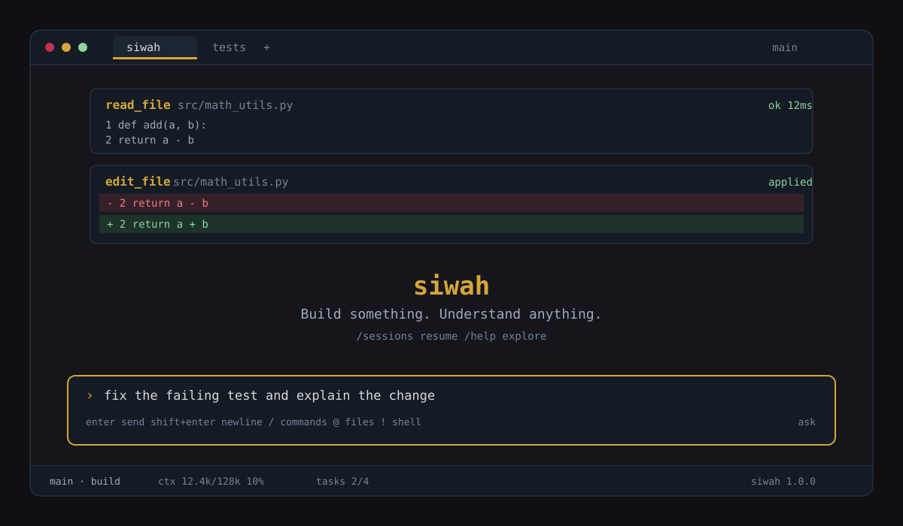

<p align="center">
  <picture>
    <source media="(prefers-color-scheme: dark)" srcset="assets/logo-dark.svg">
    <source media="(prefers-color-scheme: light)" srcset="assets/logo-light.svg">
    
  </picture>
</p>

<p align="center">
  <strong>A self-improving terminal coding agent harness.</strong><br>
  Plan, build, verify, and evolve in one local session.
</p>

<p align="center">
  <a href="https://github.com/zidanmubarak/siwah/actions/workflows/ci.yml"></a>
  <a href="LICENSE"></a>
  <a href="https://www.python.org/downloads/"></a>
  <a href="https://bun.sh/"></a>
</p>

> **Status:** `1.0.0` is the first public release. The source bootstrap is the
> primary install; the same release is uploaded to TestPyPI for verification
> before final PyPI publication.

**siwah** is a coding agent that runs in your terminal. A local Python daemon
owns sessions, tools, provider calls, permissions, checkpoints, and accounting.
A TypeScript terminal UI renders the work, while a headless runner and an Agent
Client Protocol (ACP) bridge speak to the same daemon.

The harness is editable: prompts, tool guidance, skills, commands, subagents,
hooks, and model profiles live in a git-backed directory under `~/.siwah/`.
siwah can improve that data through an evaluation-gated evolution loop, and can
gate patches to its own core code. The kernel, evaluation fixtures, and recovery
paths are protected from the agent. It is local-first: no hosted service, no
telemetry, and no hardcoded model IDs, prices, or limits.



## Features

- **Workflow:** streaming agent loop, file/edit/search/shell/web tools, verifier
  with repair loop, checkpoints, undo/rewind/fork, plan mode, compaction,
  offload, queueing, memory, and recall.
- **Terminal:** OpenTUI + Solid UI, Markdown, tool cards, diffs, task progress,
  session tabs, inline permission previews, image paste, themes, `NO_COLOR`, and
  persisted history. `--ui plain` is the no-Bun fallback.
- **Providers:** OpenAI Chat Completions-compatible endpoints, live model
  discovery, `/connect`, capability probes, role routing, fallback, effort, and
  per-step allowance accounting.
- **Safety:** `ask`/`auto-edit`/`yolo`, path guard, secret deny list,
  catastrophic-command denial, opt-in Docker/bubblewrap sandbox, kernel
  manifest, supervisor rollback, and dirty-repository refusal.
- **Extensibility:** editable prompts, guidance, skills, commands, subagents,
  profiles, hooks, and MCP; project overrides under `.siwah/`; background jobs.
- **Evaluation:** golden, heldout, and traps; mock and live modes; T0–T3 tiers;
  evolution Levels 0–2 with budget, canary, tags, rollback, and audit.

## Requirements

- Python 3.11+ and [uv](https://docs.astral.sh/uv/)
- [Bun](https://bun.sh/) 1.3.14+ for the TUI from source (a compiled binary does
  not need Bun)
- Git for checkouts, checkpoints, and updates
- An OpenAI Chat Completions-compatible provider

## Install

The bootstrap installs `uv` and Bun when missing, clones siwah to
`~/.siwah/src`, installs the editable `siwah` tool, and builds the TUI binary.

Windows PowerShell:

```powershell
irm https://raw.githubusercontent.com/zidanmubarak/siwah/main/scripts/install/bootstrap.ps1 | iex
```

macOS/Linux:

```bash
curl -fsSL https://raw.githubusercontent.com/zidanmubarak/siwah/main/scripts/install/bootstrap.sh | bash
```

Open a new terminal and run `siwah`. The checkout in `~/.siwah/src` is what
`/update` and `siwah update --apply` fast-forward.

The editable install keeps the TUI source discoverable, so `/update` can
fast-forward the checkout and rebuild the binary. The compiled TUI is written to
`ui/tui/dist/siwah-tui[.exe]` and is found automatically. For a manual checkout,
see [Getting started](docs/GETTING-STARTED.md). The 1.0.0 wheel is also uploaded
to TestPyPI for release verification, not as the primary install. See
[Releasing](docs/RELEASING.md).

## Quickstart

Start the TUI with `siwah`. The launcher starts the daemon through the
supervisor if needed. Run `/connect`, choose a provider, and paste the API key
(stored in `~/.siwah/auth.json`, mode 600). Run `/models`, choose a model, and
send a task such as: `Find the failing test, explain the cause, and fix it.`

For headless use:

```bash
siwah run "Fix the failing test in this repo" --permission auto-edit
siwah run "Summarize the project" --json
siwah run "Plan the refactor" --effort high --model opencode-go/<model-id>
```

`siwah run` uses `ask` by default. In a non-interactive environment, pass
`--permission auto-edit` for file edits or `--permission yolo` for shell
commands too. `--auto` and `--bypass` alias `yolo`; the path guard and
catastrophic-command denial remain active.

Add providers and role targets in `~/.siwah/harness/config.toml`; siwah writes
`opencode-go` and `openai` templates on first run. Restart siwah after editing
provider or role settings. Credentials come from the configured environment
variable first, then the auth file. Legacy `~/.siwah/config.toml` files are
migrated on first load. See [Configuration](docs/CONFIGURATION.md).

## Permissions

| Mode | File edits | Shell and network | Typical use |
|---|---|---|---|
| `ask` | prompt | prompt | Interactive work; the default |
| `auto-edit` | allow | prompt | Agent-driven refactors with a human watching |
| `yolo` | allow | allow | Deliberate unattended runs |

In the TUI, `/permissions` cycles the modes; `AUTO` appears in `yolo`.
`siwah --allow-all` (alias `--bypass`) starts the TUI in `yolo`. Rules can be
added per tool, path, or command with `allow`, `ask`, or `deny`; the last matching
rule wins. Default deny paths include `.env` files, SSH keys, AWS and GCloud
credentials, and `credentials.json`.

`yolo` still denies catastrophic commands that target the filesystem root,
disks, or shutdown. It does not turn the path guard into an operating-system
sandbox. See [Security](docs/SECURITY.md).

## Checkpoints and plan mode

Each session gets a shadow git repository under
`~/.siwah/checkpoints/<session-id>/`; your project `.git` is not modified.
`/undo` restores the previous checkpoint, `/rewind N` targets N steps back and
can fork, and `/checkpoints` lists snapshots (Enter restores, `f` forks).
`/compact` summarizes the model context without changing the transcript.
`/plan` enters read-only plan mode and writes `<repo>/.siwah/plan.md`;
`/execute-plan` sends the edited plan back in build mode.

## Subagents, MCP, hooks, and jobs

`task` launches isolated child sessions. `explore` and `review` are read-only;
`general` can implement. Custom specs live in
`~/.siwah/harness/subagents/*.md` or `<repo>/.siwah/subagents/*.md`. Children
cannot launch further children, and read-only batches can run in parallel.

MCP servers are configured in `~/.siwah/harness/mcp.json` or managed with
`siwah mcp add`, `list`, `status`, `show`, and `remove`. The client supports
stdio and streamable HTTP, follows tool pagination, and treats every MCP
description and result as untrusted data. Resources, prompts, sampling, and
server-initiated requests are out of scope.

Hooks live in `~/.siwah/harness/hooks/*.json`; a `PreToolUse` hook can deny a
call, while `PostToolUse` and session hooks can add context. Custom slash
commands live in the harness or project `commands/` directory. `bash` accepts
`background=true`; `jobs` lists, tails, and kills process-local jobs. On Windows,
`bash` uses Git Bash when available; `cmd.exe` is only a fallback.

## Sandbox, best-of-N, and ACP

The command sandbox is opt-in:

```toml
[sandbox]
enabled = true
backend = "docker"      # auto, docker, bwrap, or local
image = "alpine:3.20"   # any image with the project's runtime
network = false
```

Docker is used when an image is configured, bubblewrap on Linux when available,
and the local fallback is explicitly non-isolated. Sandboxed background commands
fail closed rather than running unsandboxed.

`siwah run --ultra N` runs 2–5 attempts in separate git worktrees and applies the
first passing attempt to a clean main worktree. It requires a clean repository
and does not silently spend allowance.

`siwah acp` starts an ACP v1 stdio bridge for editors. It advertises text prompts;
requests needing interactive approval are denied because client permission
dialogs are not implemented. Filesystem and terminal methods are not advertised
yet. `siwah run --json` and the daemon OpenAPI remain the primary headless
surfaces.

## Evaluation

```bash
siwah eval --suite golden
siwah eval --suite golden --baseline
siwah eval --suite golden --tier t0
siwah eval --suite traps
siwah eval --suite heldout
```

The public repository contains 30 golden tasks, 3 sample heldout tasks, and 3
traps. The full heldout suite is distributed separately and is loaded from
`SIWAH_HELDOUT_DIR`, or point `SIWAH_EVAL_DIR` at a complete evaluation tree.
Evaluation and evolution therefore need a source checkout or an explicit eval
directory; a wheel install alone is not enough.

Mock runs are deterministic and cost no allowance. Live runs are opt-in:

```bash
SIWAH_LIVE=1 siwah eval --suite golden --live \
  --model opencode-go/<model-id> --max-allowance 0.05 --max-steps 16
```

Reports include pass rate, steps, tokens, allowance, duration, tool-error rate,
cache-read ratio, and trap results. Heldout reports expose aggregate metrics
only. See [Evaluation](docs/EVALUATION.md).

## Evolution

| Level | What changes | Gate |
|---|---|---|
| 0 | Harness data, such as a prompt or guidance file | Safety validation and a T0 smoke probe |
| 1 | Multi-file harness data | T1 screening against a baseline, then a T2 gate |
| 2 | Core code outside protected paths | Isolated worktree, diff limits, tests, lint, type check, smoke boot, T0–T3 |

```bash
siwah evolve --seed                          # deterministic cold-start cycle
siwah evolve --live --model opencode-go/<model-id> --max-allowance 0.05
siwah evolve --live --seed --probe-limit 2   # cheap live smoke
siwah evolve --pause
siwah evolve log
siwah evolve --patch-file fix.diff           # Level 2 gate
siwah rollback evo-N                         # restore a harness tag
```

`--live` requires `SIWAH_LIVE=1`, a real model, and a positive per-probe
`--max-allowance`. Without `--live`, only an explicit `--seed` cycle runs; it is
a smoke fixture, not evidence of coding quality. Promotions are committed and
tagged, and the canary monitor records samples against configured thresholds.

Automatic post-session evolution is available when `[evolution].auto` is enabled
and the session signals and cooldown conditions are met. It does not opt into
paid live evaluation by itself. Production canary sampling is not connected
end-to-end, so automatic post-session rollback is not a guarantee. Use explicit
`--live` cycles when you need strict control.

Kill switches: `SIWAH_EVOLVE=off`, `SIWAH_EVOLVE_AUTO=0`, and
`siwah evolve --pause`. The default budget allows 1.0 allowance per cycle, three
cycles per day, a 40% weekly reserve, a 60-minute cooldown, and 45 minutes of
wall time. See [Evolution](docs/EVOLUTION.md).

## Known limitations

- The path guard is an **application-level guard**. A deliberately malicious
  `bash` command can still write outside the workspace unless the opt-in sandbox
  is configured. The local sandbox fallback is not isolation.
- The 1.0.0 provider adapter is OpenAI Chat Completions-compatible only.
- Evolution's canary and automatic rollback path is not end-to-end; production
  session sampling is not connected. Level 2 recovery from a delayed daemon boot
  failure is not fully journaled.
- ACP is minimal: text prompts only, no client permission dialogs, no
  `loadSession`, and no filesystem/terminal methods.
- macOS Terminal and iTerm2 were not verified for 1.0.0. Windows Terminal, tmux,
  SSH, and Windows/WSL environments were verified. See
  [Terminal support](docs/TERMINAL-SUPPORT.md).
- The full heldout suite is not public; the public samples are for format
  inspection. A wheel install does not include the TUI binary or eval fixtures.
- Some model-specific harness overlays for complex model IDs may not resolve
  through both the gate and the loader.

## Architecture

```text
siwah (launcher)
  └─ supervisor (protected)
       └─ siwah daemon (FastAPI, HTTP + SSE)
            ├─ TUI (OpenTUI + Solid)
            ├─ siwah run (headless)
            ├─ ACP bridge
            └─ editor clients
```

- `src/siwah/kernel/` — protected guard, manifest, audit, snapshot, budget,
  gate, canary, supervisor, and evolution orchestration.
- `src/siwah/core/` — agent loop, SQLite sessions, checkpoints, context,
  verifier, plan mode, subagents, and trajectories.
- `src/siwah/providers/` — configuration-driven adapter, streaming, tool calls,
  usage and allowance accounting, profiles, and repair.
- `src/siwah/tools/` — filesystem, edit, search, shell, todo, web, memory,
  skill, recall, repo-map, tool-output, task, jobs, MCP, and syntax tools.
- `src/siwah/server/` — local HTTP + SSE protocol and OpenAPI.
- `src/siwah/adapt/` — evolution candidates, probing, promotion, canary,
  Level 2 worktrees, and best-of-N.
- `ui/tui/` — TypeScript terminal interface with generated API types.
- `evals/` — protected golden, heldout, and trap fixtures.

The daemon owns one active run per session. Clients never call providers
directly. Protected paths include `src/siwah/kernel/`, `evals/`,
`tests/kernel/`, `kernel.manifest.json`, and the CLI, bootstrap, config, auth,
and profile loaders needed to enforce them. See
[Architecture](docs/ARCHITECTURE.md) and the [protocol](docs/PROTOCOL.md).

## Development

```bash
uv sync --extra dev
uv run ruff check .
uv run ruff format --check .
uv run pyright
uv run pytest

cd ui/tui && bun install && bun run lint && bun run typecheck && bun run test
```

Generated OpenAPI types are committed under `ui/tui/src/api/schema.d.ts`; CI
regenerates them and fails on drift. Build release artifacts with
`uv run python scripts/build-release.py`. See [Development](docs/DEVELOPMENT.md)
and [Releasing](docs/RELEASING.md).

## Status and roadmap

`1.0.0` is the first public release. The source bootstrap is the supported
install. Near-term work focuses on final PyPI publication, connecting production
canary sampling and rollback, completing delayed-boot recovery for Level 2,
broader provider families, stronger isolation, and macOS terminal verification.
No dates are promised. See [CHANGELOG.md](CHANGELOG.md).

## Contributing

Issues and pull requests are welcome. During 1.0.x, accepted changes may be
ported to the maintainers' canonical development tree before a release, so your
change may land in a later sync rather than as a direct merge. Read
[CONTRIBUTING.md](CONTRIBUTING.md) first. Do not change `src/siwah/kernel/`,
`evals/`, `tests/kernel/`, or `kernel.manifest.json` without maintainer approval.

For security reports, follow [SECURITY.md](SECURITY.md). Do not include API
keys, tokens, or private data in an issue.

## License

MIT. Copyright (c) 2026 Zidan Mubarak. See [LICENSE](LICENSE).

## Acknowledgements

siwah adopts **design patterns** from three open projects and respects their
licenses. No source code is copied from them.

- [opencode](https://github.com/sst/opencode) (MIT) — client/server and SSE
  architecture, permission model, provider abstraction, session storage, and
  OpenTUI + Solid terminal patterns.
- [Hermes Agent](https://github.com/NousResearch/hermes-agent) (MIT) — layered
  memory, skills created and repaired after use, session recall, and curator
  ideas.
- [Harness²](https://github.com/google-research/harness2) (Apache-2.0) — editable
  harness components and the Propose–Probe–Compose evolution loop.

The terminal interface is built with [OpenTUI](https://opentui.com/),
[Solid](https://www.solidjs.com/), and [Bun](https://bun.sh/). The daemon uses
[FastAPI](https://fastapi.tiangolo.com/), [Pydantic](https://docs.pydantic.dev/),
and [uvicorn](https://www.uvicorn.org/).
